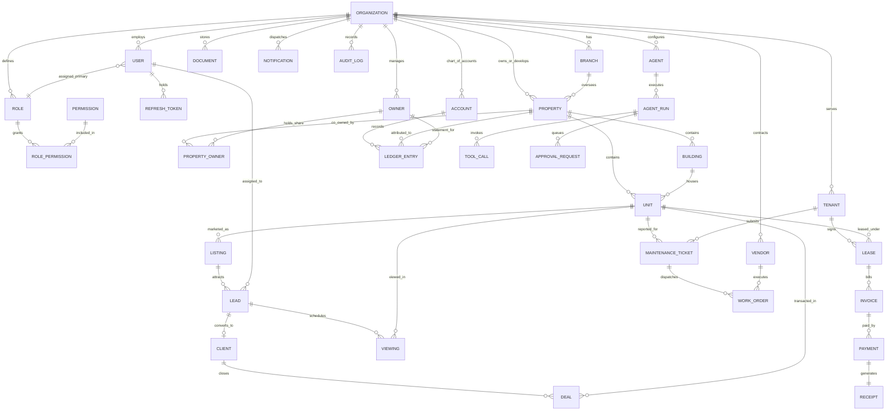

# Entity-Relationship Diagram & Data Model Specification (`docs/ERD.md`)

## 1. Universal Data Conventions

1. **Multi-Tenancy (`organization_id`)**: Every domain table includes `organization_id` referencing `organizations(id)` with row-level isolation enforced at the service/repository layer.
2. **Audit Metadata**: Every table includes `created_at` (ISO-8601 UTC timestamp), `updated_at` (ISO-8601 UTC timestamp), `created_by` (nullable User ID), and `deleted_at` (nullable ISO-8601 UTC timestamp for soft deletes).
3. **Monetary Values**: All money columns use `BIGINT`/`INTEGER` minor units (`_minor`, where `1 PKR = 100 paisa`) paired with an explicit `currency` column (default `'PKR'`).

---

## 2. Mermaid Entity-Relationship Diagram

---

## 3. Core Entities Catalog (32 Tables)

### 3.1 Identity, Multi-Tenancy & RBAC
1. **`organizations`**: `id`, `slug`, `name`, `legal_name`, `country` (`PK`), `default_currency` (`PKR`), `default_locale` (`en`), `tax_number`, `status`, `created_at`, `updated_at`, `created_by`, `deleted_at`.
2. **`branches`**: `id`, `organization_id`, `code`, `name`, `city`, `address`, `phone`, `is_headquarters`, `created_at`, `updated_at`, `created_by`, `deleted_at`.
3. **`roles`**: `id`, `organization_id`, `slug` (`admin` | `agent` | `accountant` | `maintenance_staff` | `owner` | `tenant`), `name`, `description`, `is_system`, `created_at`, `updated_at`, `created_by`, `deleted_at`.
4. **`permissions`**: `id`, `organization_id`, `code` (e.g., `properties:read`, `leases:write`, `agents:approve`), `module`, `description`, `created_at`, `updated_at`, `created_by`.
5. **`role_permissions`**: `id`, `organization_id`, `role_id`, `permission_id`, `created_at`, `updated_at`, `created_by`.
6. **`users`**: `id`, `organization_id`, `branch_id`, `role_id`, `email`, `password_hash`, `full_name`, `phone`, `locale` (`en` | `ur`), `two_factor_enabled`, `two_factor_secret`, `status` (`active` | `suspended`), `last_login_at`, `created_at`, `updated_at`, `created_by`, `deleted_at`.
7. **`refresh_tokens`**: `id`, `organization_id`, `user_id`, `token_hash`, `expires_at`, `revoked_at`, `ip_address`, `user_agent`, `created_at`, `updated_at`, `created_by`.

### 3.2 Portfolio: Owners, Properties, Buildings & Units
8. **`owners`**: `id`, `organization_id`, `user_id`, `full_name`, `cnic_ntn`, `email`, `phone`, `bank_name`, `iban`, `management_fee_pct`, `created_at`, `updated_at`, `created_by`, `deleted_at`.
9. **`properties`**: `id`, `organization_id`, `branch_id`, `code`, `name`, `type` (`housing_scheme` | `commercial_center` | `mixed_use` | `residential_complex`), `city`, `address`, `latitude`, `longitude`, `total_units`, `status`, `amenities_json`, `created_at`, `updated_at`, `created_by`, `deleted_at`.
10. **`property_owners`**: `id`, `organization_id`, `property_id`, `owner_id`, `ownership_pct`, `is_primary`, `created_at`, `updated_at`, `created_by`, `deleted_at`.
11. **`buildings`**: `id`, `organization_id`, `property_id`, `code`, `name`, `floors`, `block_sector`, `created_at`, `updated_at`, `created_by`, `deleted_at`.
12. **`units`**: `id`, `organization_id`, `property_id`, `building_id`, `unit_number`, `type` (`plot` | `house` | `shop` | `apartment` | `office`), `area_sqft`, `area_display` (e.g., `10 Marla`, `1 Kanal`, `850 Sq.Ft.`), `bedrooms`, `bathrooms`, `status` (`available` | `rented` | `sold` | `under_maintenance`), `market_price_minor`, `monthly_rent_minor`, `currency` (`PKR`), `amenities_json`, `photos_json`, `created_at`, `updated_at`, `created_by`, `deleted_at`.

### 3.3 Listings & CRM
13. **`listings`**: `id`, `organization_id`, `property_id`, `unit_id`, `slug`, `title_en`, `title_ur`, `description_en`, `description_ur`, `purpose` (`rent` | `sale`), `asking_price_minor`, `currency`, `status` (`draft` | `published` | `under_offer` | `closed`), `syndicate_portals`, `published_at`, `created_at`, `updated_at`, `created_by`, `deleted_at`.
14. **`leads`**: `id`, `organization_id`, `branch_id`, `listing_id`, `assigned_agent_id`, `full_name`, `phone`, `email`, `source` (`web` | `whatsapp` | `phone` | `email` | `walk_in`), `stage` (`new` | `contacted` | `viewing_scheduled` | `negotiation` | `won` | `lost`), `score`, `budget_minor`, `currency`, `requirements_text`, `notes_json`, `created_at`, `updated_at`, `created_by`, `deleted_at`.
15. **`clients`**: `id`, `organization_id`, `lead_id`, `full_name`, `cnic`, `phone`, `email`, `client_type` (`buyer` | `investor` | `corporate_tenant`), `created_at`, `updated_at`, `created_by`, `deleted_at`.
16. **`viewings`**: `id`, `organization_id`, `lead_id`, `unit_id`, `agent_id`, `scheduled_at`, `status` (`scheduled` | `completed` | `cancelled` | `no_show`), `calendar_event_id`, `feedback`, `created_at`, `updated_at`, `created_by`, `deleted_at`.
17. **`deals`**: `id`, `organization_id`, `lead_id`, `client_id`, `unit_id`, `primary_agent_id`, `deal_type` (`sale` | `lease`), `deal_value_minor`, `commission_pct`, `commission_minor`, `agent_splits_json`, `currency`, `status` (`pending` | `closed_won` | `cancelled`), `closed_at`, `created_at`, `updated_at`, `created_by`, `deleted_at`.

### 3.4 Tenants, Leases, Billing & Payments
18. **`tenants`**: `id`, `organization_id`, `user_id`, `full_name`, `cnic`, `phone`, `email`, `kyc_status` (`pending` | `verified`), `emergency_contact_name`, `emergency_contact_phone`, `created_at`, `updated_at`, `created_by`, `deleted_at`.
19. **`leases`**: `id`, `organization_id`, `property_id`, `unit_id`, `tenant_id`, `lease_number`, `status` (`draft` | `active` | `renewal_due` | `expired` | `terminated`), `start_date`, `end_date`, `rent_minor`, `deposit_minor`, `escalation_pct`, `due_day`, `grace_days`, `late_fee_minor`, `currency`, `document_id`, `created_at`, `updated_at`, `created_by`, `deleted_at`.
20. **`invoices`**: `id`, `organization_id`, `lease_id`, `property_id`, `unit_id`, `tenant_id`, `invoice_number`, `type` (`rent` | `utility` | `maintenance` | `late_fee`), `period_month` (`YYYY-MM`), `due_date`, `amount_minor`, `late_fee_minor`, `total_minor`, `paid_minor`, `currency`, `status` (`pending` | `partial` | `paid` | `overdue` | `void`), `created_at`, `updated_at`, `created_by`, `deleted_at`.
21. **`payments`**: `id`, `organization_id`, `invoice_id`, `tenant_id`, `method` (`bank_transfer` | `cash` | `jazzcash` | `easypaisa` | `stripe`), `reference_number`, `amount_minor`, `currency`, `status` (`completed` | `pending` | `failed` | `refunded`), `paid_at`, `created_at`, `updated_at`, `created_by`, `deleted_at`.
22. **`receipts`**: `id`, `organization_id`, `payment_id`, `invoice_id`, `tenant_id`, `receipt_number`, `amount_minor`, `currency`, `issued_at`, `pdf_url`, `created_at`, `updated_at`, `created_by`, `deleted_at`.

### 3.5 Accounting, Maintenance, Documents, Audit & AI Agents
23. **`accounts`**: `id`, `organization_id`, `code`, `name`, `type` (`asset` | `liability` | `equity` | `income` | `expense`), `currency`, `created_at`, `updated_at`, `created_by`, `deleted_at`.
24. **`ledger_entries`**: `id`, `organization_id`, `account_id`, `property_id`, `owner_id`, `invoice_id`, `payment_id`, `entry_date`, `direction` (`debit` | `credit`), `amount_minor`, `currency`, `category`, `description`, `created_at`, `updated_at`, `created_by`, `deleted_at`.
25. **`vendors`**: `id`, `organization_id`, `name`, `trade_category` (`plumbing` | `electrical` | `hvac` | `civil` | `security` | `general`), `phone`, `email`, `rating`, `base_rate_minor`, `currency`, `sla_hours`, `created_at`, `updated_at`, `created_by`, `deleted_at`.
26. **`maintenance_tickets`**: `id`, `organization_id`, `property_id`, `unit_id`, `tenant_id`, `ticket_number`, `title`, `description`, `category`, `priority` (`low` | `medium` | `high` | `emergency`), `status` (`open` | `triaged` | `assigned` | `in_progress` | `completed` | `closed`), `sla_due_at`, `photos_json`, `created_at`, `updated_at`, `created_by`, `deleted_at`.
27. **`work_orders`**: `id`, `organization_id`, `ticket_id`, `vendor_id`, `work_order_number`, `status` (`draft` | `scheduled` | `in_progress` | `completed`), `estimated_cost_minor`, `actual_cost_minor`, `currency`, `scheduled_at`, `completed_at`, `created_at`, `updated_at`, `created_by`, `deleted_at`.
28. **`documents`**: `id`, `organization_id`, `entity_type`, `entity_id`, `title`, `category`, `version`, `storage_key`, `mime_type`, `size_bytes`, `tags_json`, `expiry_date`, `content_text`, `embedding_json`, `created_at`, `updated_at`, `created_by`, `deleted_at`.
29. **`notifications`**: `id`, `organization_id`, `user_id`, `channel` (`in_app` | `email` | `sms` | `whatsapp`), `recipient`, `subject`, `body`, `status` (`queued` | `sent` | `read` | `failed`), `is_ai_drafted`, `sent_at`, `created_at`, `updated_at`, `created_by`, `deleted_at`.
30. **`audit_logs`**: `id`, `organization_id`, `actor_user_id`, `action`, `entity_type`, `entity_id`, `ip_address`, `user_agent`, `metadata_json`, `created_at`, `updated_at`, `created_by`.
31. **`agents`**: `id`, `organization_id`, `slug`, `name`, `description`, `goal`, `autonomy_level` (`suggest_only` | `act_with_approval` | `act_autonomously`), `is_enabled`, `cost_budget_minor`, `currency`, `allowed_tools_json`, `created_at`, `updated_at`, `created_by`, `deleted_at`.
32. **`agent_runs`**, **`tool_calls`**, **`approval_requests`**:
    - `agent_runs`: `id`, `organization_id`, `agent_id`, `trigger_type`, `input_text`, `reasoning_summary`, `output_text`, `status` (`running` | `awaiting_approval` | `completed` | `failed` | `killed`), `tokens_used`, `cost_minor`, `currency`, `approved_by`, `created_at`, `updated_at`, `created_by`.
    - `tool_calls`: `id`, `organization_id`, `agent_run_id`, `tool_name`, `input_json`, `output_json`, `requires_approval`, `status`, `duration_ms`, `created_at`, `updated_at`, `created_by`.
    - `approval_requests`: `id`, `organization_id`, `agent_run_id`, `tool_call_id`, `agent_slug`, `action_type`, `summary`, `payload_json`, `status` (`pending` | `approved` | `rejected`), `reviewed_by`, `reviewed_at`, `review_note`, `created_at`, `updated_at`, `created_by`.
