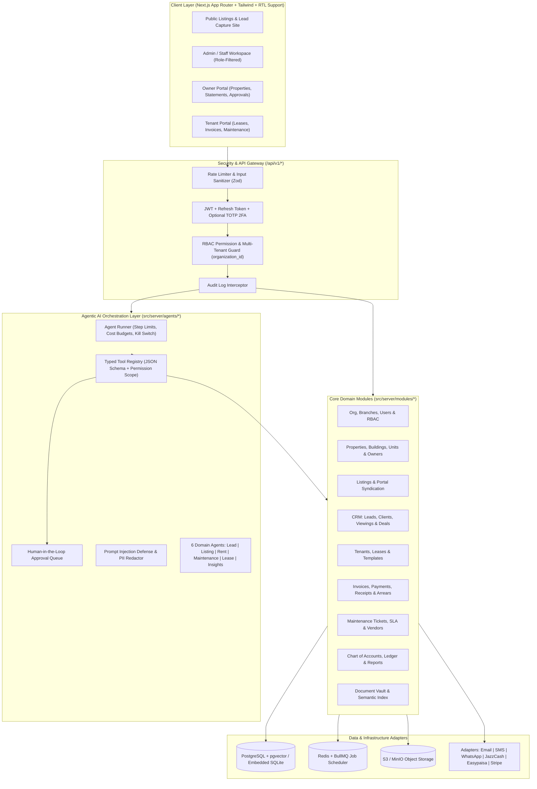

# Engineering Master Plan (`docs/PLAN.md`)

## 1. System Architecture Diagram



---

## 2. Technology Stack & Justification

1. **Frontend:** Next.js 15 (App Router), React 19, TypeScript 5, Tailwind CSS, Lucide Icons.
   - *Why:* Server + Client components, built-in routing, mobile-first responsive layouts, and first-class support for dynamic `dir="rtl"` / `dir="ltr"` switching for Urdu (`ur`) and English (`en`).
2. **Backend:** Modular TypeScript Server Architecture (`src/server/`) integrated with Next.js Route Handlers (`/api/v1/*`).
   - *Why:* Eliminates cross-container CORS issues in preview environments while maintaining strict layered boundaries (Controllers → Services → Repositories → Adapters), full Zod schema validation, and fast Vitest execution.
3. **Database:** PostgreSQL 16 + `pgvector` (`prisma/schema.prisma` + Docker Compose) with a zero-config `node:sqlite` repository engine for local sandbox & CI runs.
   - *Why:* Guarantees production readiness with `pgvector` embeddings and ACID transactions while enabling instant one-command startup (`npm run dev` and `npm test`) even where Docker daemons are unavailable.
4. **Authentication & Security:** Custom HMAC-SHA256 JWT + stateful Refresh Token rotation + RFC 6238 TOTP 2FA + granular RBAC (`36` permissions across `6` roles) + strict row-level `organization_id` isolation.
5. **AI Layer:** Anthropic Claude Tool-Use Orchestrator with a typed Tool Registry, Human-in-the-Loop `ApprovalRequest` queue, per-agent kill switches, token/cost tracking in PKR/USD minor units, and deterministic policy-aware simulation when `ANTHROPIC_API_KEY` is not set.

---

## 3. Repository Folder Structure

```text
real-estate-management-system/
├── .github/workflows/
│   └── ci.yml                      # GitHub Actions CI pipeline (lint, test, coverage, build)
├── docs/
│   ├── PLAN.md                     # Architecture plan, stack decisions, risk register
│   ├── ERD.md                      # Complete 32-table Entity Relationship Diagram & specs
│   └── API.md                      # OpenAPI / REST endpoint documentation
├── prisma/
│   └── schema.prisma               # Production PostgreSQL + pgvector schema (all 32 models)
├── src/
│   ├── app/                        # Next.js App Router pages & API route handlers
│   │   ├── api/v1/                 # Versioned REST API endpoints
│   │   │   ├── auth/               # login, refresh, logout, me, context, 2fa/setup, 2fa/verify
│   │   │   ├── admin/              # users, roles, permissions, organizations, branches, audit-logs
│   │   │   └── health/             # Health check & system metrics endpoint
│   │   ├── login/                  # Multi-role login page with 2FA & demo role cards
│   │   ├── dashboard/              # Authenticated role-aware workspace
│   │   ├── layout.tsx              # Root layout with i18n / RTL provider
│   │   └── page.tsx                # Landing & quick entry
│   ├── components/                 # Reusable UI components (Sidebar, Header, RBAC Matrix, etc.)
│   ├── lib/                        # Shared utilities, i18n dictionaries (EN/UR), currency formatters
│   └── server/                     # Backend application core
│       ├── auth/                   # JWT, RefreshToken, Password hashing, TOTP 2FA, RBAC Guard
│       ├── db/                     # Schema DDL, database connection, seed dataset (PakLand + Indus)
│       ├── modules/                # Domain services (org, auth, audit, properties, etc.)
│       └── adapters/               # Storage, Payments, Notifications, Queue adapters
├── tests/                          # Unit & integration test suites (Vitest)
├── DECISIONS.md                    # Architectural & domain defaults log
├── PROGRESS.md                     # Phase-by-phase build tracker
├── docker-compose.yml              # PostgreSQL (pgvector), Redis, MinIO, App services
├── Dockerfile                      # Multi-stage production container build
└── .env.example                    # Documented environment variables template
```

---

## 4. Risk Register & Mitigations

| # | Risk | Impact | Likelihood | Mitigation Strategy |
|---|---|---|---|---|
| 1 | **Cross-Tenant Data Leakage** | Critical | Low | Every table has `organization_id`. Repository functions require `organizationId` as a mandatory parameter; automated integration tests verify zero data leakage between `org_pakland` and `org_indus`. |
| 2 | **Floating-Point Rounding in Accounting/Rent** | High | Medium | All monetary amounts (`rent_minor`, `amount_minor`, `balance_minor`, `cost_minor`) are stored as integers in minor units (`1 PKR = 100 paisa`) with explicit `currency` code. |
| 3 | **Unauthorized Autonomous AI Actions** | Critical | Medium | Tools affecting money, external bulk messaging, lease modifications, legal/arrears notices, or deletions carry `requiresApproval: true` in the Tool Registry and are intercepted into `approval_requests` before execution. |
| 4 | **Prompt Injection via Untrusted Lead/Tenant Input** | High | Medium | Untrusted strings are wrapped in delimited data blocks, sanitized for instruction overrides, and tools enforce RBAC + tenant permissions independently of LLM output. |
| 5 | **RTL Layout Breakage in Urdu Mode** | Medium | Medium | Logical Tailwind utilities and explicit `dir="rtl"` / `dir="ltr"` root attributes ensure seamless bidirectional rendering. |
